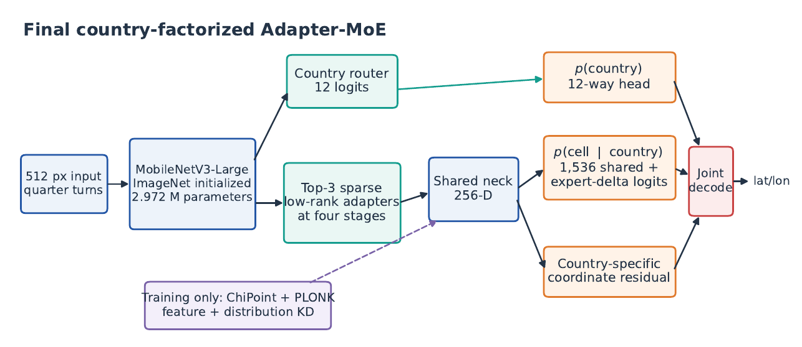
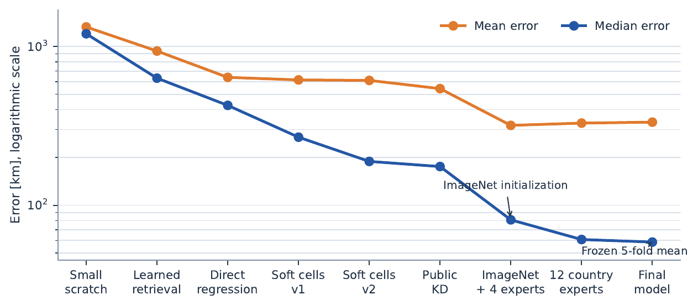

# Alidade

**Compact European Image Geolocation with Country-Routed Low-Rank Experts**

A **4.96M-parameter** image-geolocation model for twelve European countries.
The model combines MobileNetV3-Large, country-balanced geocells, sparse low-rank
experts, and adaptive knowledge distillation from ChiPoint and PLONK.

> **Release status:** public research artifact. The challenge dataset and holdout
> predictions are not distributed. The current licence is all rights reserved;
> see `LICENSE` and `THIRD_PARTY.md` before reuse or redistribution.



## Results

Frozen five-fold cross-validation on 11,758 labelled images:

| Metric | Mean over folds |
|---|---:|
| Median haversine error | **58.554 km** |
| Mean haversine error | **333.777 km** |
| Within 100 km | **57.944%** |
| Within 200 km | **66.219%** |
| Within 750 km | **86.137%** |
| Country accuracy | **82.113%** |

The final all-data student trained for 72 epochs in **81.49 minutes** on an
NVIDIA RTX 4000 Ada Generation. Teacher inference and target construction are
reported separately.

## How it works

1. MobileNetV3-Large extracts shared visual features from a 512 x 512 image.
2. An early country-supervised router selects three of twelve low-rank experts.
3. The selected experts adapt intermediate features and geocell logits.
4. Shared heads predict a country distribution, 1,536 country-balanced geocells,
   and a country-specific coordinate residual.
5. The decoder combines `p(country)` and `p(cell | country)`, averages the three
   strongest coherent cells, and applies the residual.
6. Predictions from four quarter-turn views are averaged before decoding.

The experts are adapters, not twelve complete models. Most computation and
parameters remain shared.

## Parameter count

| Counting convention | Scalar values |
|---|---:|
| PyTorch `nn.Parameter` elements | **4,964,188** |
| Complete model `state_dict` including BatchNorm buffers | 4,988,634 |
| Saved geocell centres | 4,608 |
| Complete inference state | **4,993,242** |

Even the strict final count remains 6,758 values below the five-million limit.
Run `verify.py` to reproduce the audit.

## Repository layout

```text
.
├── model.py                       # architecture, decoder, losses and data code
├── predict.py                     # generic directory-based inference
├── train.py                       # complete clean training pipeline
├── train_student.py               # fixed 72-epoch student training
├── cache_chipoint.py              # ChiPoint target preparation
├── cache_plonk.py                 # PLONK target preparation
├── prepare_teacher_targets.py     # adaptive teacher fusion
├── verify.py                      # checkpoint and prediction audit
├── final_model.pt                 # released checkpoint (Git LFS)
├── MODEL_CARD.md
├── THIRD_PARTY.md
├── docs/EXPERIMENTS.md
└── results/                       # timing and parameter evidence
```

## Installation for inference

Python 3.12 was used for the final run. Install Git LFS before cloning so that
`final_model.pt` is downloaded rather than left as a pointer file.

```bash
git lfs install
git clone https://github.com/Clemens-R/Alidade.git
cd Alidade
python3.12 -m venv .venv
source .venv/bin/activate
python -m pip install --upgrade pip
```

Install a PyTorch build appropriate for the machine. The final workstation used
CUDA 13.0:

```bash
python -m pip install torch==2.13.0 torchvision==0.28.0 \
  --index-url https://download.pytorch.org/whl/cu130
python -m pip install -r requirements-inference.txt
```

For CPU-only inference:

```bash
python -m pip install torch==2.13.0 torchvision==0.28.0 \
  --index-url https://download.pytorch.org/whl/cpu
python -m pip install -r requirements-inference.txt
```

If these wheel URLs are no longer available for a platform, install a mutually
compatible PyTorch/torchvision pair first and then install the remaining
requirements.

## Predict arbitrary images

Put images in one directory and run:

```bash
python predict.py \
  --image-dir /path/to/images \
  --checkpoint final_model.pt \
  --output predictions.csv \
  --device auto
```

Supported extensions are `.jpg`, `.jpeg`, `.png`, and `.webp`. Add `--recursive`
to scan subdirectories. The output contains:

```csv
filename,pred_lat,pred_lng
example.jpg,48.1234,11.5678
```

CUDA is recommended. CPU inference works but is substantially slower because the
model evaluates four rotated views per image.

To reproduce the challenge holdout file exactly:

```bash
python predict.py \
  --image-dir /path/to/geo_dataset/holdout_public \
  --checkpoint final_model.pt \
  --output predictions_reproduced.csv \
  --expected-count 2400 \
  --device cuda
```

## Reproduce training

The challenge dataset is not distributed in this repository. It must have this
layout:

```text
geo_dataset/
├── train/
├── train_labels.csv
└── holdout_public/
```

Install the full training environment without replacing the selected PyTorch
build:

```bash
python -m pip install -r requirements-training.txt
```

Then run the complete workflow:

```bash
DATA_DIR=/absolute/path/to/geo_dataset ./run_training.sh
```

The launcher waits for sufficient free GPU memory, builds fresh ChiPoint and
PLONK outputs, constructs distillation targets, trains the student, predicts the
holdout, and verifies all artifacts. Progress is written to
`final_training.log`; outputs are placed in `final_training_run/`.

Teacher weights and retrieval resources are downloaded through their normal
public model caches. No external images are added to student training.

## Verification and tests

```bash
python verify.py \
  --checkpoint final_model.pt \
  --output-dir verification_reproduced

# Optionally validate a challenge-format file you generated locally:
python verify.py \
  --checkpoint final_model.pt \
  --predictions predictions.csv \
  --expected-rows 2400 \
  --output-dir verification_with_predictions

python -m unittest discover -s tests -v
```

Continuous integration performs syntax checks, unit tests, safe checkpoint
loading, and parameter-count validation.

## Experiments



`docs/EXPERIMENTS.md` summarizes the main successful and failed experiments.
It covers direct coordinate regression, retrieval, soft geocells,
MobileNetV3/V4, alternative routing schemes, teacher comparisons, adaptive
distillation, loss ablations, and five-fold evaluation. Aggregate experiment,
timing, and parameter evidence is available in `results/`.

## Scope and responsible use

This is a research model for a fixed twelve-country domain, not a global or
safety-critical geolocator. Large country-level errors remain possible.
Geolocation can expose sensitive location information; process only imagery you
are authorized to use. See `MODEL_CARD.md` for limitations.

## Licence and third-party material

This public research artifact is currently **all rights reserved**; publishing
source code is not the same as granting an open-source licence. The challenge
dataset and holdout predictions are not included. Third-party software, teacher
models, pretrained weights, and datasets retain their own terms. See `LICENSE`
and `THIRD_PARTY.md`.
